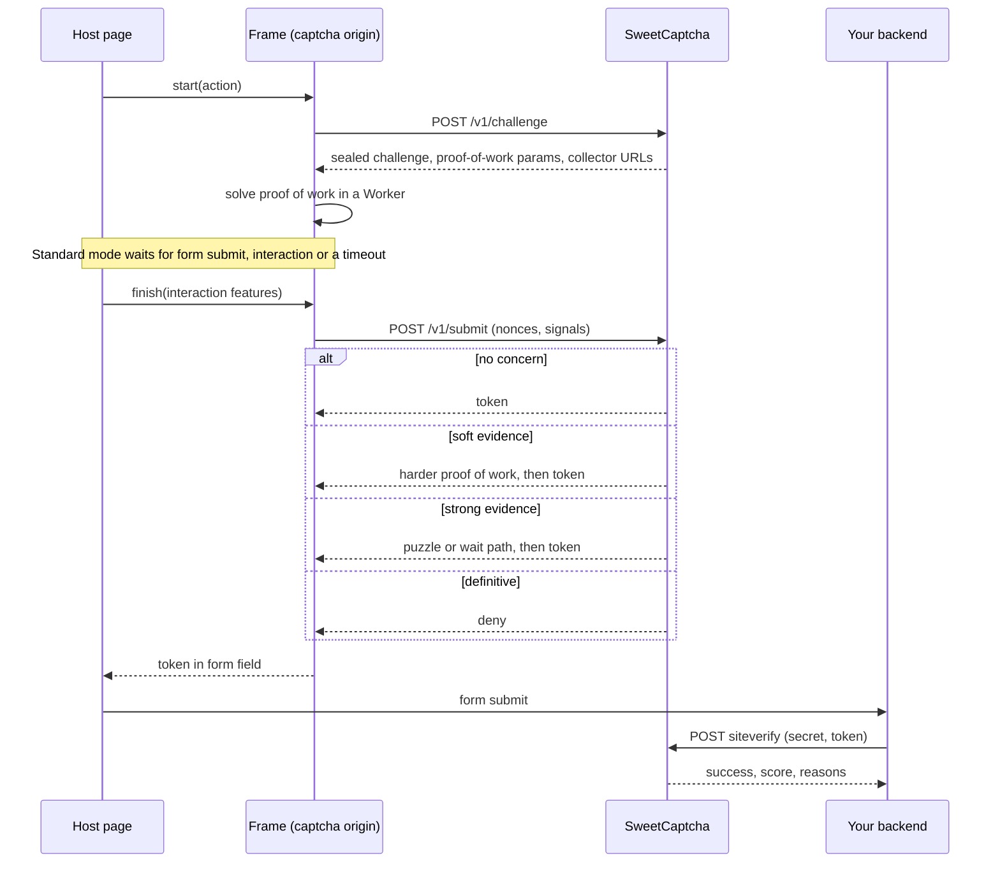

# Architecture

## Components

| Component | Role |
|---|---|
| `api.js` loader | Runs in the host page. Renders the frame, fills the form field, exposes the provider API. Reads no device data. |
| Frame | Runs on the captcha origin. Requests the challenge, runs proof of work in a Worker, shows status and tasks. |
| Collectors (`signals-*`) | Standard mode only. Loaded when the server asks for them. Absent from the strict-only image. |
| Go service | Issues challenges and tokens, verifies work, scores evidence, serves compatibility routes. |
| Valkey | Short-lived state only, with persistence off. Every key has a TTL. A memory store is available for one process. |
| `ipdata` sidecar | Refreshes public IP lists daily. The only service with internet access. Standard stack only. |

## Verification flow

In standard mode, a form's token is minted when the form is submitted, so the evidence covers the whole interaction. Pages that use a callback get a token shortly after the first interaction, or after 8 seconds idle. A token minted before interaction carries no behaviour evidence, which is a known gap for bots that wait.

## What is trusted

The client is never trusted. Anything it sends can be fabricated, and the source is public.

| Concern | Client | Server |
|---|---|---|
| Verdict | Shows status only | Computed from server-held policy |
| Proof of work | Solves | Sets the parameters, verifies, consumes once |
| Signals | Reduces to coarse values | Cross-checks against headers and TLS, and assumes they may be forged |
| Secrets | Holds none | Holds all keys |

Signals only ever add suspicion through contradiction. Their absence counts only when it is itself a contradiction: the collector not running, or a mouse click with no approach path.

## Tokens and challenges

- All values handed to clients are AES-256-GCM sealed, using keys derived by HKDF from the master key with separate purposes. A challenge can't be used as a token, and clients can't read scores or reasons.
- Challenges last 2 minutes and are consumed once.
- Tokens last 5 minutes by default, and redemption is an atomic `SET NX`. If the store is unavailable, verification **fails closed**.
- Site verification enforces the secret's ownership of the token, hostname and action allow lists, expiry and single use, on every API flavour. Hosted providers leave hostname and action checks to the integrator.
- Hostnames reported by clients can be spoofed outside a browser. In browsers, `frame-ancestors` enforces the allow list.

## Scoring

The engine starts from a prior log-odds of −2, about 12%, and adds capped per-group log-likelihood ratios. Grouping keeps correlated signals from one root cause from counting several times.

| Band (default) | Response |
|---|---|
| p < 0.5 | Pass |
| 0.5 ≤ p < 0.8 | Step-up proof of work |
| p ≥ 0.8 | Puzzle or wait path |
| p ≥ 0.995, with hard and network evidence | Deny |
| Explicit automation marker | Deny (`policy.on_definitive`) |

Behaviour can never cause a deny on its own: at realistic base rates it can't be precise enough. Passing a step lowers suspicion, but the reported score stays below that of a silent pass.

## Interactive tasks

Image recognition grids are not used, because they are cheaply solved. There are three procedurally generated families: tracing tangled lines, finding rings with gaps, and rotating shapes to match. Each has a keyboard path, answers stay on the server, and each puzzle allows one answer. These tasks have a shrinking margin against vision models and should not be treated as a security boundary.

None of them suits everyone, so the **wait path** offers a longer computation with no task. It costs an attacker CPU and time, reports a low score, and is closed to clients with explicit automation markers. A site can also show a support link.

## Editions

The `strictonly` build tag removes `internal/risk`, `internal/tlsfp`, `internal/ipdata`, `internal/puzzle` and the collector bundles from the binary. CI checks both the Go dependency graph and the contents of the image. Configuration asking for standard mode is refused at startup.

## Not implemented

These appear in the research but are not built yet: HTTP/2 and header-order fingerprints, Web Bot Auth for signed agents, timezone against IP-country checks, Private Access Tokens, rotating or obfuscated collectors, and automatic per-site threshold tuning. The admin page gives a read-only threshold suggestion instead, since self-tuning could be poisoned.
